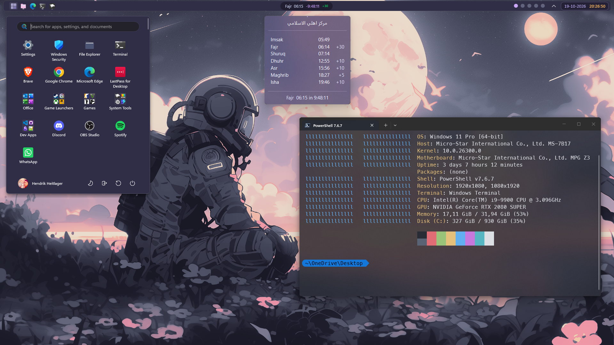

# Mawaqit Prayer Clock

Bring your mosque’s prayer times to the **Windows 11 taskbar** with a live countdown, a prayer schedule popup, and customizable themes. An unofficial [Windhawk](https://windhawk.net/) mod.

> **Upcoming release:** v0.8.0 is in final testing. The latest public catalog release remains v0.7.1.
>
> **Before upgrading to v0.8.0:** back up your current settings. The new settings structure resets existing appearance, layout, popup, display, and custom-color choices to v0.8.0 defaults. Your **mosque identifier, selected theme, and taskbar position** are preserved. No migration helper is included with this release, so other settings must be reapplied manually.

| Windows / System | Traditional Islamic |
|:---:|:---:|
|  |  |
| Catppuccin Mocha | Emberveil |
|  |  |

## At a glance

- Next prayer, scheduled time, and live countdown on your taskbar
- Daily prayer schedule popup with click or configurable hover opening
- **26 predefined themes** plus a Custom theme, with independent pill and popup color overrides
- Six taskbar positions and primary/secondary monitor controls
- 12-hour or 24-hour prayer times, optional AM/PM, and optional Hijri date
- Floating or taskbar-attached pill and popup layouts, with configurable typography and materials
- Mawaqit schedule retrieval with local caching

## Getting started

1. Install [Windhawk](https://windhawk.net/) and find **Mawaqit Prayer Clock** in its mod catalog.
2. Enable the mod and open its settings.
3. **Find your mosque.** Visit [Mawaqit](https://mawaqit.net/) if you already know its page, or [search Google for a Mawaqit mosque near you](https://www.google.com/search?q=mawaqit+mosque+near+me). Open the mosque’s Mawaqit page and copy its full URL or mosque ID (the last part of the URL) into the mod’s **Mosque** setting.

4. Pick a theme and preferred taskbar position. You're ready!

## Make it yours

See the **[Theme Gallery & Customization Guide](docs/guides/THEMES.md)** for the theme list, color roles, and override examples. See the **[Configuration Reference](CONFIGURATION.md)** for every setting and default.

The screenshots currently in this repository show v0.7.1. They are illustrative and do not show every v0.8.0 option or theme.

## Guides & project information

| Guide | What you'll find |
|---|---|
| [Themes](docs/guides/THEMES.md) | Theme list, color roles, and custom overrides |
| [Configuration](CONFIGURATION.md) | Settings, valid values, and defaults |
| [Troubleshooting](TROUBLESHOOTING.md) | Common issues and diagnostics |
| [Changelog](docs/releases/CHANGELOG.md) | Released and candidate milestones |
| [Release notes](docs/releases/RELEASE_NOTES.md) | Detailed release information and upgrade notes |
| [Development](docs/development/DEVELOPMENT.md) | Source versions, testing, and contributing |
| [Roadmap](docs/planning/ROADMAP.md) | Current milestone and planned work |

## Compatibility

Windows 11 with Windhawk (2.0+ recommended). Internet access to `mawaqit.net` is needed to retrieve schedules; the mod uses a local cache when available. Windows taskbar internals may change across builds, and other taskbar mods may affect positioning.

This is an independent, unofficial community project, **not affiliated with or endorsed by Mawaqit**. Verify important prayer times with your mosque. Licensed under [MIT](LICENSE).
