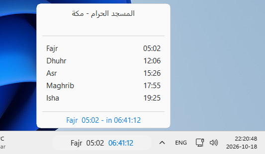
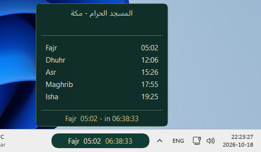
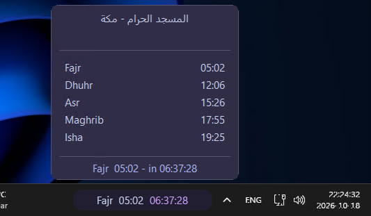
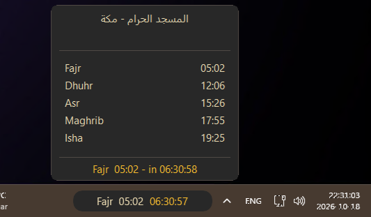
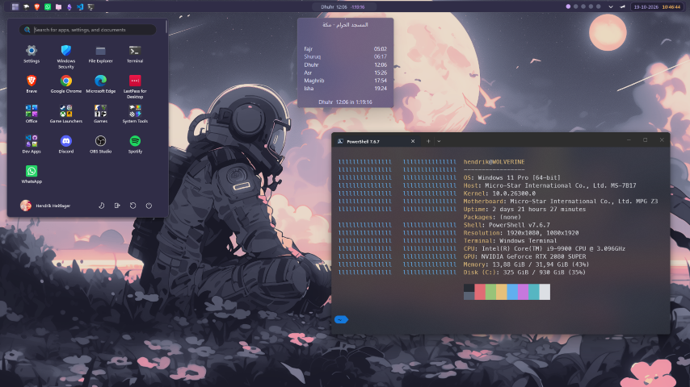

# Mawaqit Prayer Clock

Bring your mosque’s prayer times to the **Windows 11 taskbar** with a live countdown, a prayer schedule popup, and customizable themes. An unofficial [Windhawk](https://windhawk.net/) mod.

**Status:** v0.7.0 accepted into Windhawk · v0.7.1 source release available in this repository (upstream update pending)

| Windows / System | Traditional Islamic |
|:---:|:---:|
|  |  |
| Catppuccin Mocha | Emberveil |
|  |  |

## At a glance

- Next prayer, scheduled time, and live countdown on your taskbar
- Clickable prayer schedule popup, with optional hover interaction
- 14 selectable themes, including Emberveil Daybreak, plus customizable pill and popup colors
- Five taskbar positions and support for multiple monitors
- Mawaqit schedule retrieval with local caching
- **In v0.7.1:** Optional Imsak and Shuruq popup rows, source-scheduled Adhan-to-Iqamah handling (including midnight Isha), automatic pill width, dynamically sized mosque headers, expanded theme presets, and separate popup appearance controls

## Getting started

1. Install [Windhawk](https://windhawk.net/) and find **Mawaqit Prayer Clock** in its mod catalog.
2. Enable the mod and open its settings.
3. **Find your mosque.** Visit [Mawaqit](https://mawaqit.net/) if you already know its page, or [search Google for a Mawaqit mosque near you](https://www.google.com/search?q=mawaqit+mosque+near+me) to discover a nearby mosque. Mawaqit does not currently offer a convenient nearby-mosque search on its website. Open the mosque’s Mawaqit page and copy its full URL or the mosque ID (the last part of the URL) into the mod’s **Mosque** setting.

4. Pick a theme and preferred taskbar position. You're ready!

## Make it yours

See the **[Theme Gallery & Customization Guide](THEMES.md)** for every built-in palette, color-role reference, and mix-and-match examples.

## Guides & project information

| Guide | What you'll find |
|---|---|
| [Themes](THEMES.md) | Gallery, full color palettes, and custom overrides |
| [Configuration](CONFIGURATION.md) | Settings, valid values, and examples |
| [Troubleshooting](TROUBLESHOOTING.md) | Common issues and diagnostics |
| [Changelog](CHANGELOG.md) | Released milestones |
| [Release notes](RELEASE_NOTES.md) | Detailed release information |
| [Development](DEVELOPMENT.md) | Source versions, testing, and contributing |
| [Roadmap](ROADMAP.md) | Planned features, upcoming milestones, and a sneak peek at what's next |

## Compatibility

Windows 11 with Windhawk (2.0+ recommended). Internet access to `mawaqit.net` is needed to retrieve schedules; the mod uses a local cache when available. Windows taskbar internals may change across builds, and other taskbar mods may affect positioning.

This is an independent, unofficial community project, **not affiliated with or endorsed by Mawaqit**. Verify important prayer times with your mosque. Licensed under [MIT](LICENSE).
