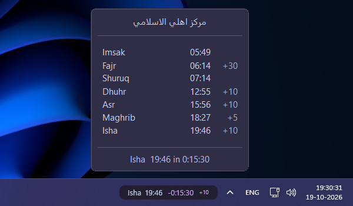

# Themes & customization

Choose a ready-made look or mix individual colors. This guide reflects the **v0.7.1 repository source release**; some options may not yet be present in the accepted v0.7.0 release.

## Gallery

The gallery shows the **v0.7.1 preset previews** alongside their source-defined pill palette colors. Screenshots are real captures; prayer times and countdowns may differ because they were taken at different moments. Windows / System follows Windows appearance and accent settings. Custom starts with fallback colors that can be overridden.

| Theme | Pill background | Prayer text | Countdown | Separator | Preview |
|---|---|---|---|---|---|
| **Traditional Islamic** | `#123D34` | `#F5EAD3` | `#E4C784` | `#C9B789` |  |
| **Emerald Mosque** | `#102B27` | `#F3E8CF` | `#D4AF70` | `#B6C9BD` |  |
| **Emberveil** | `#171B20` | `#F5E6C8` | `#FFBC5E` | `#D9A441` |  |
| **Emberveil Midnight** | `#0A0C0E` | `#F5E6C8` | `#FFBC5E` | `#B8A98A` |  |
| **Emberveil Daybreak** | `#FFF2D8` | `#1A1F26` | `#B87924` | `#8A642D` |  |
| **Catppuccin Mocha** | `#211E32` | `#CDD6F4` | `#CFA1FF` | `#A6ADC8` |  |
| **Dracula** | `#282A36` | `#F8F8F2` | `#BD93F9` | `#6272A4` |  |
| **Nord** | `#2E3440` | `#ECEFF4` | `#88C0D0` | `#81A1C1` |  |
| **Gruvbox Dark** | `#282828` | `#EBDBB2` | `#FABD2F` | `#928374` |  |
| **Tokyo Night** | `#1A1B26` | `#C0CAF5` | `#7AA2F7` | `#565F89` |  |
| **Solarized Dark** | `#002B36` | `#93A1A1` | `#B58900` | `#586E75` |  |
| **Solarized Light** | `#FDF6E3` | `#586E75` | `#268BD2` | `#93A1A1` |  |
| **Windows / System** | Windows accent | White | White | White |  |

**Windows / System:** Accent-filled pill with white prayer text, countdown and separators by default. The accent follows Windows highlight; users with pale accents or transparent pill backgrounds can adjust text colors through custom overrides. Live pill refresh on Windows appearance changes is deferred to v0.8.0. **Custom fallback:** pill `#211E32`, prayer `#F5E6C8`, countdown `#FFBC5E`, separator `#B8A98A`.

## Custom theme showcase

A deliberately bold example of what is possible with **Advanced → Custom theme settings**. **Neon Maghrib** is a community-style example, **not** an included preset. It uses Catppuccin Mocha as its base, with a solid pill, a blurred popup, and the following custom overrides.

| Custom theme setting | Value | Custom theme setting | Value |
|---|---|---|---|
| `PillBackground` | `#080122` | `PopupBackground` | `#080122` |
| `PillText` | `#FC2281` | `PopupBorder` | `#FC2281` |
| `PillSeparator` | `#FC2281` | `PopupText` | `#F7A2F7` |
| `PillCountdown` | `#F7A2F7` | `PopupMuted` | `#FC2281` |
| `PillIqamah` | `#F72655` | `PopupRule` | `#FC2281` |
| `PillBorder` | `#FC2281` | `PopupFooter` | `#F7A2F7` |

To reproduce the look, select **General → Theme → Catppuccin Mocha**, then enter these colors under **Advanced → Custom theme settings**. Under **Advanced → Layout settings**, set **Background style** to **Solid**, **Background opacity** to **100%**, **Show pill border** to **On**, and **Fontsize** to **20**. Under **Advanced → Popup appearance**, set **Popup background material** to **Blur** and enable **Show popup border** and **Show popup separators**. The example also uses **Display → Show Shuruq and Imsak** and **Show Iqamah time**.

> **Tip:** Apply the values individually instead of pasting a complete saved configuration. That way, your mosque selection, taskbar position, and other personal settings stay unchanged. Saved custom colors remain active when switching to other presets until cleared.

## Popup palettes

| Theme | Background | Border | Text | Muted | Divider | Footer |
|---|---|---|---|---|---|---|
| **Traditional Islamic** | `#102F29` | `#527361` | `#F5EAD3` | `#C9B789` | `#527361` | `#E4C784` |
| **Emerald Mosque** | `#102B27` | `#386057` | `#F3E8CF` | `#B6C9BD` | `#386057` | `#D4AF70` |
| **Emberveil** | `#171B20` | `#212832` | `#F5E6C8` | `#F5E6C8` | `#212832` | `#D9A441` |
| **Emberveil Midnight** | `#101418` | `#353A3E` | `#F5E6C8` | `#B8A98A` | `#353A3E` | `#FFBC5E` |
| **Emberveil Daybreak** | `#F5E6C8` | `#E2CFA8` | `#1A1F26` | `#6F624F` | `#E2CFA8` | `#B87924` |
| **Catppuccin Mocha** | `#302D47` | `#58536F` | `#CDD6F4` | `#A6ADC8` | `#58536F` | `#B4BEFE` |
| **Dracula** | `#282A36` | `#44475A` | `#F8F8F2` | `#BFBFD0` | `#44475A` | `#BD93F9` |
| **Nord** | `#2E3440` | `#4C566A` | `#ECEFF4` | `#D8DEE9` | `#4C566A` | `#88C0D0` |
| **Gruvbox Dark** | `#282828` | `#504945` | `#EBDBB2` | `#A89984` | `#504945` | `#FABD2F` |
| **Tokyo Night** | `#1A1B26` | `#414868` | `#C0CAF5` | `#A9B1D6` | `#414868` | `#7AA2F7` |
| **Solarized Dark** | `#002B36` | `#586E75` | `#93A1A1` | `#839496` | `#586E75` | `#B58900` |
| **Solarized Light** | `#FDF6E3` | `#EEE8D5` | `#586E75` | `#657B83` | `#93A1A1` | `#268BD2` |

**Windows / System:** light popup `#FAFAFA` / dark popup `#202020`; footer follows Windows highlight. **Custom fallback:** `#1D1D2D`, `#3B3B58`, `#D3D0E8`, `#B8B3D1`, `#424158`, `#A29DBB` (in table column order).

## What each color controls

| Pill role | Purpose |
|---|---|
| `PillBackground` | Clock pill fill |
| `PillText` | Prayer name/time |
| `PillSeparator` | Divider between text sections |
| `PillCountdown` | Main countdown accent |
| `PillIqamah` | Iqamah suffix; empty follows the resolved countdown color |
| `PillBorder` | Optional border; empty follows countdown accent |

Imsak and Shuruq use the primary popup text color by default; Iqamah offsets use the muted/secondary color. The popup has six independent roles: `PopupBackground`, `PopupBorder`, `PopupText`, `PopupMuted`, `PopupRule` (divider lines), and `PopupFooter`. The pill and popup also have separate material/opacity controls; those change how colors appear on screen.

## Light popup colors with Blur and Acrylic

A light `PopupBackground` color (for example, an off-white or pale cream) can look **much brighter, washed out, or almost white** when the popup uses **Blur** or **Acrylic**. These Windows composition materials blend the popup tint with the content behind it, so the result may not match the exact `#RRGGBB` color you entered. The desktop wallpaper, nearby windows, and Windows appearance can also change how the tint looks.

For a more predictable result, try **Solid** popup background mode. If you prefer Blur or Acrylic, try a **darker `PopupBackground` override** and adjust the available popup opacity setting to see which combination works best on your desktop. Increasing opacity may help in some configurations, but these effects do not guarantee an exact color match. This is expected material behavior rather than an indication that your hex value was rejected.

See [Troubleshooting](TROUBLESHOOTING.md#light-popup-background-looks-white-or-washed-out) for a quick checklist.

## Mix and match

1. Select any preset under **General → Theme**.
2. Open **Advanced → Custom theme settings**.
3. Enter a `#RRGGBB` value in only the fields you want to change. Leave other fields empty to inherit the selected preset.
4. For example, choose **Nord** and set `PillCountdown` to `#FFBC5E` for an Emberveil-gold countdown.
5. To restore a preset color, clear the corresponding override.

**Important:** Saved nonempty overrides continue to apply after switching presets. Invalid hex values are ignored and inherit the base palette. `PillIqamah` and `PillBorder` follow the *resolved* countdown color when empty.

**Iqamah sizing:** Advanced → Layout settings → `IqamahFontScale` sets the Iqamah suffix to 50–100% of the base pill font (default 80%); it is vertically centered beside the countdown.

For complete settings, see [CONFIGURATION.md](CONFIGURATION.md). For help, see [TROUBLESHOOTING.md](TROUBLESHOOTING.md).
