# Themes & customization

Choose a ready-made look or build your own palette. This guide covers the themes and color controls planned for **v0.8.0**; v0.7.1 remains the latest public Windhawk release. The screenshots below are real v0.7.1 captures, while the palette values reflect the v0.8.0 source. Prayer times and countdowns vary with the moment the screenshots were taken.

## Theme previews

These preview cards show the themes already represented in the repository screenshots. They remain useful for comparing the overall look; v0.8.0 adds more palettes and independent color roles.

| Theme                   | Pill background | Prayer text | Countdown | Separator | Preview                                                                        |
| ----------------------- | --------------- | ----------- | --------- | --------- | ------------------------------------------------------------------------------ |
| **Traditional Islamic** | `#123D34`       | `#F5EAD3`   | `#E4C784` | `#C9B789` | 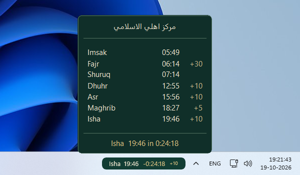 |
| **Emerald Mosque**      | `#102B27`       | `#F3E8CF`   | `#D4AF70` | `#B6C9BD` | 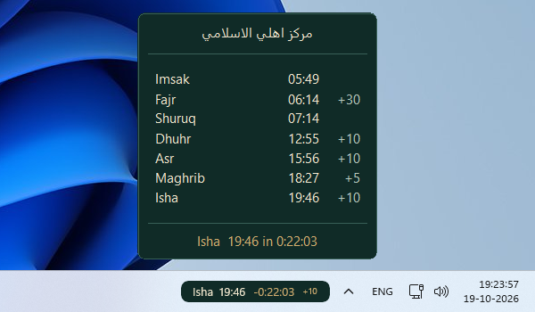                |
| **Emberveil**           | `#171B20`       | `#F5E6C8`   | `#FFBC5E` | `#D9A441` |                      |
| **Emberveil Midnight**  | `#0A0C0E`       | `#F5E6C8`   | `#FFBC5E` | `#B8A98A` | 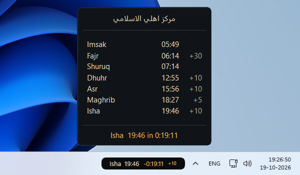        |
| **Emberveil Daybreak**  | `#FFF2D8`       | `#1A1F26`   | `#B87924` | `#8A642D` | 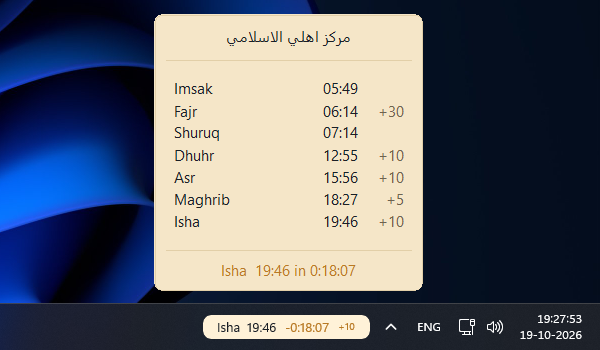        |
| **Catppuccin Mocha**    | `#211E32`       | `#CDD6F4`   | `#CFA1FF` | `#A6ADC8` |        |
| **Dracula**             | `#282A36`       | `#F8F8F2`   | `#BD93F9` | `#6272A4` | 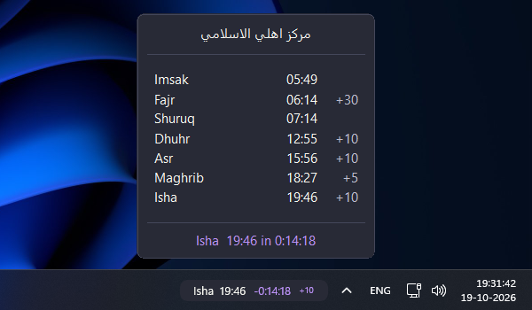                              |
| **Nord**                | `#2E3440`       | `#ECEFF4`   | `#88C0D0` | `#81A1C1` | 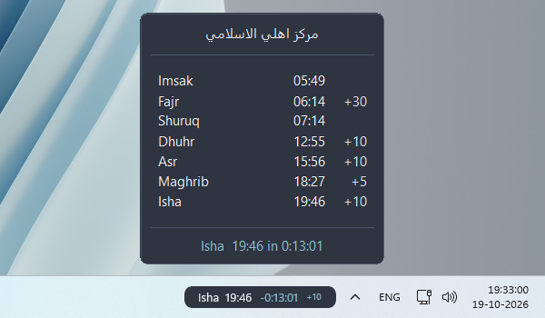                                    |
| **Gruvbox Dark**        | `#282828`       | `#EBDBB2`   | `#FABD2F` | `#928374` | 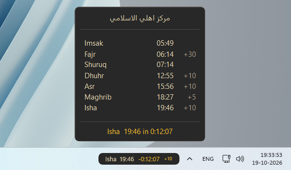                    |
| **Tokyo Night**         | `#1A1B26`       | `#C0CAF5`   | `#7AA2F7` | `#565F89` | 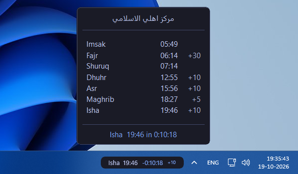                      |
| **Solarized Dark**      | `#002B36`       | `#93A1A1`   | `#B58900` | `#586E75` | 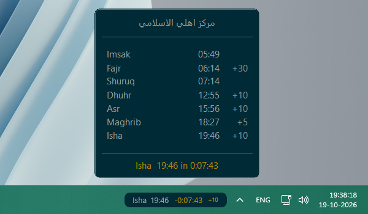                |
| **Solarized Light**     | `#FDF6E3`       | `#586E75`   | `#268BD2` | `#93A1A1` | 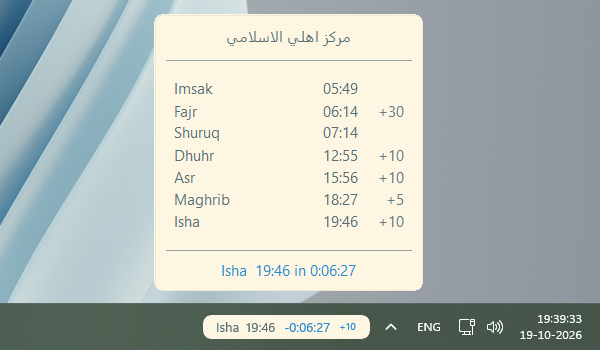              |
| **Windows / System**    | Windows accent  | White       | White     | White     | 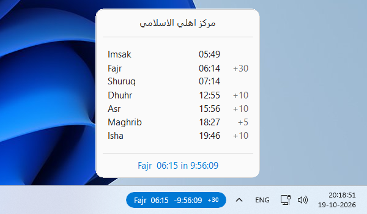 |

## More palettes in v0.8.0

v0.8.0 offers **26 predefined themes** plus **Custom**. The following themes have no updated screenshot card yet, so their pill palettes are shown directly for comparison. Monochrome follows Windows light/dark appearance when automatic theme switching is enabled.

| Theme | Pill background | Prayer text | Countdown | Separator |
|---|---|---|---|---|
| **Monochrome — dark** | `#202020` | `#F4F4F4` | `#D0D0D0` | `#B8B8B8` |
| **Monochrome — light** | `#F2F2F2` | `#202020` | `#404040` | `#666666` |
| **Catppuccin Latte** | `#EFF1F5` | `#4C4F69` | `#8839EF` | `#6C6F85` |
| **Dracula Light** | `#F8F7FC` | `#292537` | `#7545B5` | `#655D77` |
| **Nord Light** | `#ECEFF4` | `#2E3440` | `#3B668B` | `#4C566A` |
| **Gruvbox Light** | `#FBF1C7` | `#3C3836` | `#9D0006` | `#665C54` |
| **Tokyo Night Day** | `#E1E2E7` | `#343B58` | `#2959AA` | `#61709A` |
| **Rosé Pine** | `#191724` | `#E0DEF4` | `#EB6F92` | `#908CAA` |
| **Everforest** | `#2D353B` | `#D3C6AA` | `#A7C080` | `#9DA9A0` |
| **SynthWave ’84** | `#0E0B1F` | `#F8F8FF` | `#00E5FF` | `#B9A6FF` |
| **Flexoki** | `#FFFCF0` | `#100F0F` | `#205EA6` | `#6F6E69` |
| **Kanagawa** | `#1F1F28` | `#DCD7BA` | `#98BB6C` | `#C8C093` |
| **Ayu** | `#0B0F14` | `#E6E1CF` | `#FFB454` | `#8A9199` |
| **One Dark** | `#282C34` | `#ABB2BF` | `#61AFEF` | `#7F848E` |

With **Automatic light/dark theme** enabled, matching pairs switch with Windows appearance: Catppuccin Mocha/Latte, Emberveil/Daybreak, Dracula/Dracula Light, Nord/Nord Light, Gruvbox Dark/Light, Tokyo Night/Tokyo Night Day, and Solarized Dark/Light. Themes without a counterpart keep their selected palette. Windows / System uses the Windows accent for its pill background.

## Popup palettes

Popup colors are designed separately from pill colors. Each row lists the source palette in **background, border, text, muted text, divider, footer** order.

| Theme | Background | Border | Text | Muted | Divider | Footer |
|---|---|---|---|---|---|---|
| **Traditional Islamic** | `#102F29` | `#527361` | `#F5EAD3` | `#C9B789` | `#527361` | `#E4C784` |
| **Emerald Mosque** | `#102B27` | `#386057` | `#F3E8CF` | `#B6C9BD` | `#386057` | `#D4AF70` |
| **Emberveil** | `#171B20` | `#212832` | `#F5E6C8` | `#F5E6C8` | `#212832` | `#D9A441` |
| **Emberveil Midnight** | `#101418` | `#353A3E` | `#F5E6C8` | `#B8A98A` | `#353A3E` | `#FFBC5E` |
| **Emberveil Daybreak** | `#F5E6C8` | `#E2CFA8` | `#1A1F26` | `#6F624F` | `#E2CFA8` | `#B87924` |
| **Catppuccin Mocha** | `#302D47` | `#58536F` | `#CDD6F4` | `#A6ADC8` | `#58536F` | `#B4BEFE` |
| **Catppuccin Latte** | `#EFF1F5` | `#DCE0E8` | `#4C4F69` | `#6C6F85` | `#DCE0E8` | `#8839EF` |
| **Dracula** | `#282A36` | `#44475A` | `#F8F8F2` | `#BFBFD0` | `#44475A` | `#BD93F9` |
| **Dracula Light** | `#F8F7FC` | `#DCD6E9` | `#292537` | `#655D77` | `#DCD6E9` | `#7545B5` |
| **Nord** | `#2E3440` | `#4C566A` | `#ECEFF4` | `#D8DEE9` | `#4C566A` | `#88C0D0` |
| **Nord Light** | `#ECEFF4` | `#D8DEE9` | `#2E3440` | `#4C566A` | `#D8DEE9` | `#3B668B` |
| **Gruvbox Dark** | `#282828` | `#504945` | `#EBDBB2` | `#A89984` | `#504945` | `#FABD2F` |
| **Gruvbox Light** | `#FBF1C7` | `#D5C4A1` | `#3C3836` | `#665C54` | `#D5C4A1` | `#9D0006` |
| **Tokyo Night** | `#1A1B26` | `#414868` | `#C0CAF5` | `#A9B1D6` | `#414868` | `#7AA2F7` |
| **Tokyo Night Day** | `#E1E2E7` | `#C4C8DA` | `#343B58` | `#61709A` | `#C4C8DA` | `#2959AA` |
| **Solarized Dark** | `#002B36` | `#586E75` | `#93A1A1` | `#839496` | `#586E75` | `#B58900` |
| **Solarized Light** | `#FDF6E3` | `#EEE8D5` | `#586E75` | `#657B83` | `#93A1A1` | `#268BD2` |
| **Rosé Pine** | `#191724` | `#403B50` | `#E0DEF4` | `#908CAA` | `#403B50` | `#F6C177` |
| **Everforest** | `#2D353B` | `#475258` | `#D3C6AA` | `#9DA9A0` | `#475258` | `#DBBC7F` |
| **SynthWave ’84** | `#0E0B1F` | `#FF2D9C` | `#F8F8FF` | `#B9A6FF` | `#1A1038` | `#00E5FF` |
| **Flexoki** | `#FFFCF0` | `#DAD8CE` | `#100F0F` | `#6F6E69` | `#DAD8CE` | `#205EA6` |
| **Kanagawa** | `#1F1F28` | `#54546D` | `#DCD7BA` | `#C8C093` | `#54546D` | `#E6C384` |
| **Ayu** | `#0B0F14` | `#39424C` | `#E6E1CF` | `#A6A39B` | `#39424C` | `#59C2FF` |
| **One Dark** | `#282C34` | `#4B5263` | `#ABB2BF` | `#9DA5B4` | `#4B5263` | `#98C379` |

**Monochrome:** dark mode uses `#202020` / `#D0D0D0` for background / border; light mode uses `#F2F2F2` / `#404040`. Text and accents follow the monochrome contrast palette. **Windows / System:** popup background follows Windows light/dark appearance and the footer follows the Windows accent. **Custom fallback:** `#1D1D2D`, `#3B3B58`, `#D3D0E8`, `#B8B3D1`, `#424158`, `#A29DBB` in the same column order.

## Custom theme example

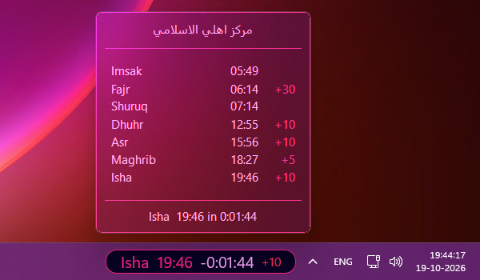

**Neon Maghrib** is a community-style example, not an included preset. It uses Catppuccin Mocha with a solid pill, blurred popup, and custom colors:

| Pill override | Value | Popup override | Value |
|---|---|---|---|
| Background | `#080122` | Background | `#080122` |
| Text | `#FC2281` | Border | `#FC2281` |
| Separator | `#FC2281` | Text | `#F7A2F7` |
| Countdown | `#F7A2F7` | Muted | `#FC2281` |
| Iqamah | `#F72655` | Rule | `#FC2281` |
| Border | `#FC2281` | Footer | `#F7A2F7` |

To reproduce it, choose **Catppuccin Mocha**, then enter these values under **Theme color overrides**. Set the pill background to **Solid**, opacity to **100%**, enable **Show pill border**, and choose font size **20**. For the popup, choose **Blur** and enable its border and separators. The example also uses **Show Shuruq and Imsak** and **Show Iqamah time**.

## The 21 independent color roles

All overrides accept six hexadecimal digits with or without `#`, such as `#FFBC5E` or `FFBC5E`. Surrounding whitespace is ignored. Empty or invalid values inherit the resolved theme color. Nonempty overrides continue to apply when switching themes until cleared.

| Group | Roles |
|---|---|
| **Pill** | Background, Border, Icon, Text, Countdown, Iqamah, Hijri date, Separator |
| **Popup** | Background, Border, Mosque name, Hijri date, Icon, Text, Muted, Iqamah, Rule, Next-prayer background, Next-prayer border, Next-prayer text, Footer |

An empty pill border follows the countdown accent; an empty pill icon follows prayer text. Popup next-prayer highlight colors inherit the theme’s accent and row text. Each role can be overridden independently. Pill and popup materials and opacity are also controlled separately.

## Translucent popup colors

A light popup background can look brighter or washed out with **Blur** or **Acrylic**. Windows blends these materials with the content behind the popup, so the visible tint may differ from the exact hex value. Try **Solid** for a predictable color, or adjust the override and popup opacity for translucent materials.

## Mix and match

1. Choose a preset under **General → Theme**.
2. Open **Theme color overrides**.
3. Change only the roles you want and leave the rest empty to inherit the theme.
4. To restore a theme color, clear that role’s override.

For example, select **Nord**, set **Pill → Countdown** to `FFBC5E`, and leave **Pill → Iqamah** empty to inherit the resolved countdown accent. The Iqamah suffix can be sized from 50–100% of the pill font using **Taskbar pill → Typography → Iqamah font scale**.

For all settings, see the [Configuration Reference](../../CONFIGURATION.md). For display issues, see [Troubleshooting](../../TROUBLESHOOTING.md).
